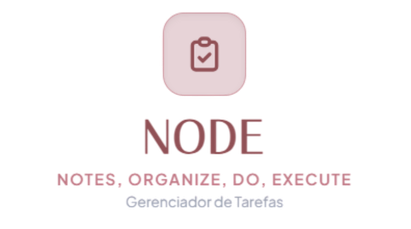

<p align="center">
  
</p>

# taskHub

Aplicação web full-stack desenvolvida com Node.js, PostgreSQL e Tailwind CSS, focada no gerenciamento eficiente de tarefas, autenticação segura e esteira automatizada de CI/CD.

> **Identidade Visual:**
> - **Tipografia:** *Outfit* (marca "taskHub"), *Unbounded* (títulos de destaque) e *Urbanist* (textos simples e interface)
> - **Paleta de Cores:** Seashell Rosé (`#FAF0EB` - Fundo principal), Card Aveludado Suave (`#FBF4EE`), Rosy Brown (`#BC8F8F`) e Rosa Berry Fechado (`#8A2D52` / `#5A1634`)

---

## 🚀 Tecnologias Utilizadas

- **Backend:** Node.js (Express), JWT, BcryptJS
- **Frontend:** HTML5, JavaScript (Vanilla), Tailwind CSS
- **Banco de Dados:** PostgreSQL
- **Servidor Web / Proxy Reverso:** Caddy
- **Containerização:** Docker & Docker Compose
- **CI/CD:** GitHub Actions & GitHub Container Registry (`ghcr.io`)

---

## 📌 Funcionalidades

### Autenticação
- `POST /api/usuarios` — Cadastro de novos usuários com senhas criptografadas.
- `POST /api/login` — Autenticação de usuários com geração de token JWT.

### CRUD de Tarefas (Protegido por JWT)
- `GET /api/tarefas` — Lista as tarefas do usuário autenticado (READ).
- `POST /api/tarefas` — Cria uma nova tarefa com título, descrição e data/hora de vencimento opcional (CREATE).
- `PUT /api/tarefas/:id` — Atualiza título, descrição, status de conclusão ou data/hora (UPDATE).
- `DELETE /api/tarefas/:id` — Remove uma tarefa existente (DELETE).

### Produtividade & UI
- **Visualização em Grade por Mês:** Organização automática das tarefas agrupadas pelo mês de vencimento.
- **Data e Hora de Vencimento:** Suporte a agendamentos com exibição formatada.
- **Filtros de Status:** Filtragem em tempo real (Todas, Pendentes, Concluídas).

### Monitoramento
- `GET /healthz` — Consulta real no banco (`SELECT 1`) retornando status `200 OK` para validar a saúde da aplicação.

---

## 🛠️ Como Executar o Projeto Localmente

1. **Clone o repositório:**
   ```bash
   git clone [https://github.com/lab-rodrigor/atividade2-crud-anna.alves.git](https://github.com/lab-rodrigor/atividade2-crud-anna.alves.git)
   cd atividade2-crud-anna.alves
